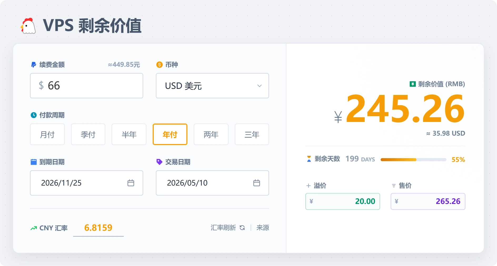
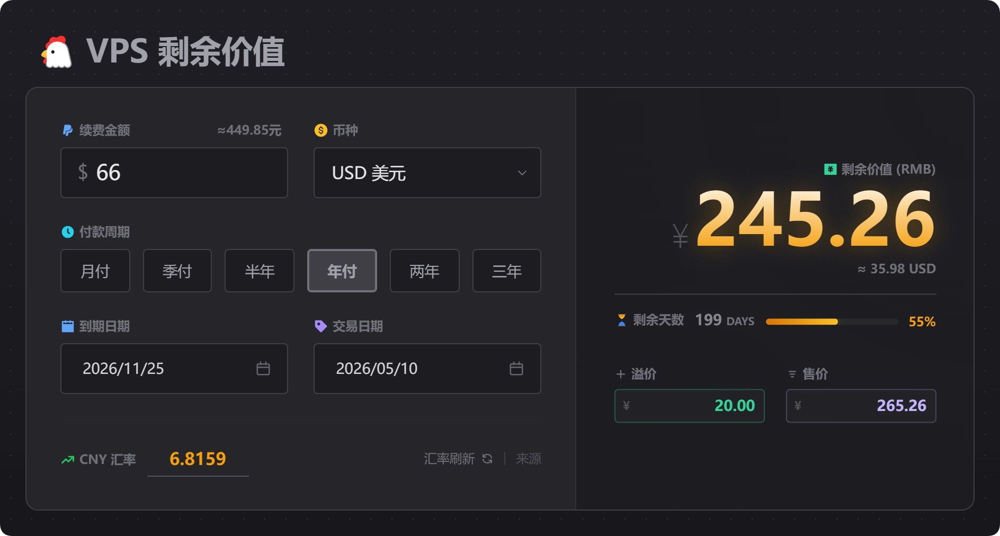

这是一个简单美观的 VPS 剩余价值计算器，支持多种货币、自定义汇率，并可以生成精美的分享图片。





✨ **特性**：
- 💰 支持多币种自动汇率转换 (USD, EUR, GBP, JPY 等)
- 📅 自动计算剩余天数和金额
- 🎨 支持深色/浅色模式切换
- 🖼️ **一键生成交易卡片图片** (纯前端生成，无隐私泄露)
- 🔗 **图片可复制为直链分享**（可选，需配置 Cloudflare KV，见下文）
- 📱 适配移动端和 PC 端

---


## 🚀 部署

### Cloudflare Pages / Vercel / EdgeOne Pages

本项目是纯静态网站，支持直接部署到任何静态托管平台。

- **构建命令**: `npm run build`
- **输出目录**: `dist`

### Cloudflare Workers

已配置 `wrangler.toml`，支持通过 Workers 部署静态资源：

```bash
npx wrangler deploy
```
#### 一键 Cloudflare 部署：

[](https://deploy.workers.cloudflare.com/?url=https://github.com/verkyer/vps-jsq)

## 🔗 图片直链分享（可选）

生成分享图后，预览框里会出现「复制图片链接」按钮：图片上传到 Cloudflare KV，得到
`https://<你的域名>/i/<id>` 这样的直链，可直接贴到聊天里，1 年后自动过期。

启用步骤：

1. Cloudflare 后台 → **Storage & databases → KV** → Create namespace（如 `vps-jsq-share`），复制其 ID；
2. 把 ID 填进 `wrangler.toml`，取消 `[[kv_namespaces]]` 三行的注释；
3. 重新部署。

未配置时按钮自动隐藏，站点其余功能不受影响。

接口限制：单图 ≤512KB、仅 webp/png/jpeg、单 IP 每天 10 张、全站每天 20 张，图片保留 90 天。
按这个组合，存储硬上限 = 20 × 90 × 512KB ≈ 900MB，仍在 KV 免费额度（1GB 存储 / 每天 1000 次写入 /
10 万次读取）之内；实际导出图 84~120KB，正常使用 90 天只占 100~200MB。

## 🛠️ 开发与构建

本项目使用 Vite + Tailwind CSS 构建。

1. 安装依赖：
   ```bash
   npm install
   ```

2. 启动本地开发服务器：
   ```bash
   npm run dev
   ```

3. 构建生产环境代码（生成 `dist/` 目录）：
   ```bash
   npm run build
   ```

4. 跑测试（计算逻辑 + Worker 接口冒烟）：
   ```bash
   npm test
   ```

---

## 📝 许可证
Apache-2.0 License
